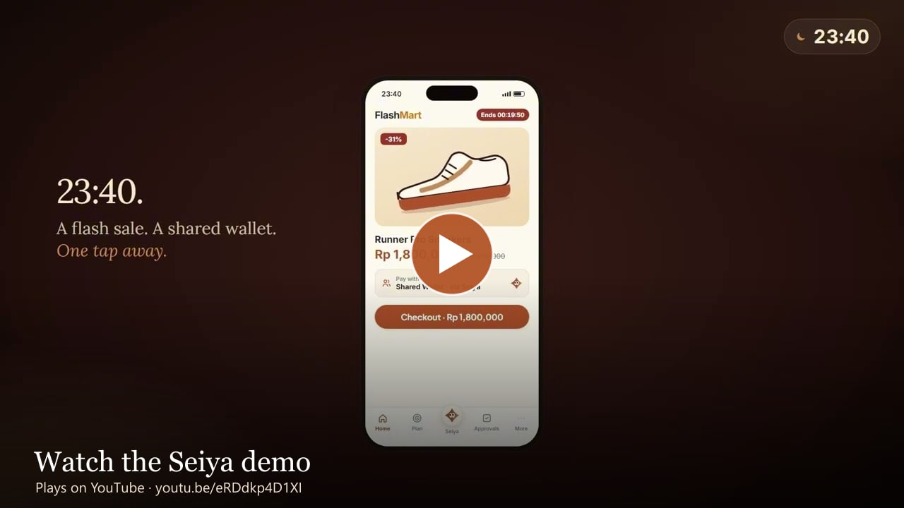
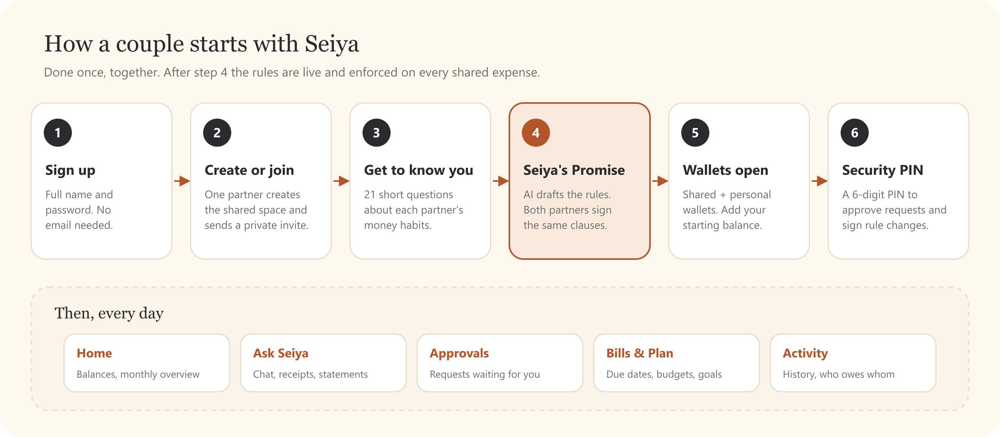
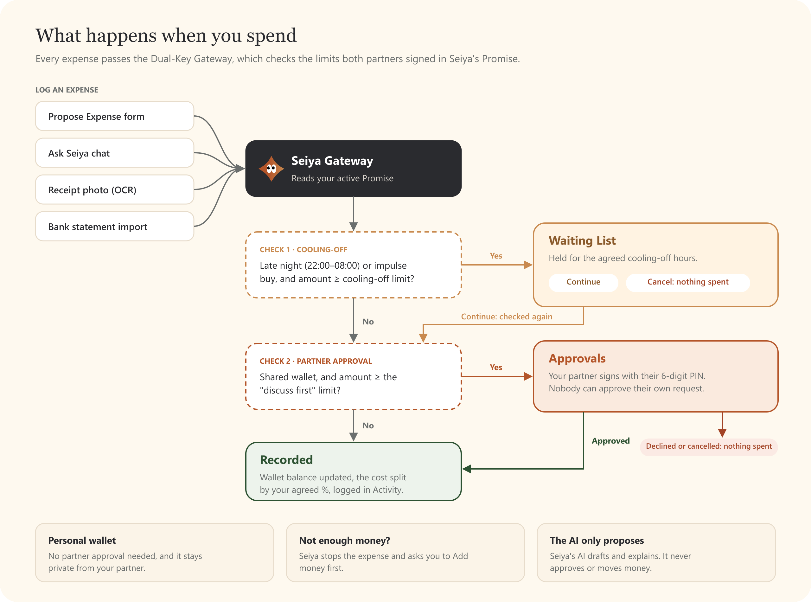

<div align="center">


<br />

[](https://seiya.web.id)


**[Open the app](https://seiya.web.id)** · [Demo video](#demo-video) · [How it works](#how-it-works) · [Features](#features) · [Run it locally](#run-it-locally) · [Developer guide](docs/DEVELOPER.md)

</div>

---

## What is Seiya?

Money fights between couples rarely start with big decisions. They start with small surprises: a purchase the other person didn't know about, a late-night impulse buy, a bill nobody remembered.

**Seiya** is a couple-finance co-pilot that prevents those surprises:

- 🤝 **Agree once.** Both partners sign one set of money rules, called **Seiya's Promise**.
- 🔑 **Seiya enforces it.** Big shared purchases need the partner's PIN. Late-night impulse buys wait until morning.
- 🔒 **Privacy stays.** Personal wallets stay personal. Only shared money is decided together.
- 💬 **Just ask.** Log spending, scan a receipt or add a bill by chatting with Seiya.

> All money in this MVP is **simulated**. No endpoint moves real money.

## Demo video

<div align="center">

[](https://youtu.be/eRDdkp4D1XI)

▶️ **[Watch on YouTube](https://youtu.be/eRDdkp4D1XI)**

</div>

## How it works

### 1 · Start together



### 2 · Every expense passes the Dual-Key Gateway



The rules come from the numbers both partners agreed on. They are enforced by the database (RLS and server-side functions), never by the screen or by the AI.

## Features

| | Feature | What it does |
|---|---|---|
| 📜 | **Seiya's Promise** | The AI drafts the rules from both partners' answers: cost split, "discuss first" limit, cooling-off, privacy. The rules go live when both sign the same version. |
| 🔑 | **Dual-key approvals** | A shared expense above the limit waits for the partner's 6-digit PIN. You can never approve your own request. |
| ⏳ | **Waiting List** | Late-night or impulse buys above the cooling-off limit are held. Afterwards you continue (checked again) or cancel. |
| 💬 | **Ask Seiya** | Chat in your own words: "I spent 150k on groceries", "add the electricity bill", "how much do we have left?". |
| 🧾 | **Receipts and statements** | Receipt photos are read on your device (OCR). Bank statements (PDF, Excel, CSV) are imported after you confirm. |
| 👛 | **Wallets** | One shared wallet and one personal wallet each, with Add money, a starting balance and multi-currency support. |
| 📅 | **Bills and Plan** | Due dates, recurring bills, budgets and couple goals. Deleting a shared goal needs both partners. |
| ⚖️ | **Settle up** | Each shared expense is split by your agreed %, so Seiya always knows who owes whom. |

## Built with

| Layer | Technology |
|---|---|
| App | Next.js 16 (App Router), React 19, TypeScript, Tailwind CSS 4 |
| Data and auth | Supabase: Postgres, Row Level Security, server-side RPCs |
| AI | Provider router with fallback (Groq → Mistral → OpenRouter → Cloudflare), RAG over the product knowledge |
| On-device reading | `tesseract.js` (receipt OCR), `unpdf`, SheetJS |
| Hosting | Vercel, Singapore region (`sin1`), next to the database |

## Run it locally

Requires Node.js 20+, a Supabase project and at least one AI provider key.

```bash
npm install
cp .env.example .env.local   # fill in the values
npx supabase db push         # apply the database migrations
npm run dev                  # http://localhost:3000
```

Environment variables, database, deployment, the full API reference and the test scripts are in the **[Developer guide](docs/DEVELOPER.md)**.

---

<div align="center">
  
  <br />
  <sub>Seiya · money decisions, made together · <a href="https://seiya.web.id">seiya.web.id</a></sub>
</div>
